# OpenVolleyScout

<p align="center">
  
</p>

<p align="center">
  <b>Free volleyball scouting and match analysis.</b><br/>
  Scout live, study the numbers, link every action to the video, prepare the next opponent.
</p>

<p align="center">
  <a href="https://scout.volleyserve.it"><b>Open the web app</b></a> ·
  <a href="https://github.com/napo/openvolleyscout/releases/latest"><b>Download</b></a> ·
  <a href="docs/user-guide.md">User guide</a> ·
  <a href="https://scout.volleyserve.it/privacy.html">Privacy</a>
</p>

<p align="center">
  <a href="https://github.com/napo/openvolleyscout/releases/latest"></a>
  
  
  
</p>

<p align="center">
  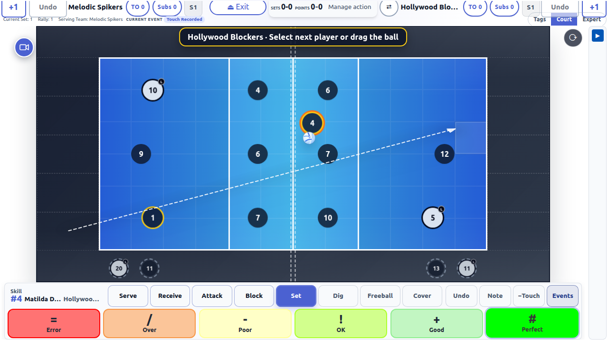
</p>

OpenVolleyScout is a volleyball scouting application for coaches, scouts and
analysts. It records every touch of a match, produces DataVolley-style reports
and statistics, synchronises actions with the match video and builds tactical
reports on the next opponent. It works in the browser and as an app for
Windows, macOS, Linux and Android, also offline in the gym.

Your data stays on your device. There are no accounts and no tracking; if you
want the same archive on several devices, connect your own Google Drive,
OneDrive or Dropbox.

## What you can do

**Scout live**
- Three ways to enter a match, switchable at any time: **Court** (large touch
  buttons, draw zones and ball directions), **Detailed** (full DataVolley code
  input) and **Tags** (buttons only, also while watching the video).
- Lineups, substitutions, libero exchanges, timeouts, score corrections and undo;
  the match resumes after a page reload.
- Scout only your own team when you do not need the opponent.
- Watch a local file, YouTube, a webcam or an RTSP camera while scouting, with
  each touch remembering its video time.

**Analyse**
- Match report (the DataVolley scoresheet), team and player performance,
  play-by-play, side-out study, cross-rotation analysis, heatmaps and radar charts.
- Trends across matches: priorities against your own wins, season trend,
  competition comparison, similarity between teams.
- Team data study across many matches, with the same views.
- Export to PDF, PPTX, ODS and SVG, or share a link that opens the same page
  on any device.

**Video**
- Synchronise a local or YouTube video with the actions, filter clips, fix codes
  and export selected clips.
- Build playlists of actions and share them as a link.

**Prepare the next opponent**
- Tactical reports built from the opponent's matches: priorities, serve targets
  by rotation, setting distribution, block and defence, "How they serve" sheet
  and free drawing sheets, printable as a booklet.
- Reception and defence systems per team, starting from P-S-C / P-C-S presets,
  with a positional-fault check.

**Your data**
- Import DataVolley (`.dvw`) and Tiebreak Tech (`.db`, `.sqlite`) matches;
  export back to DataVolley and Tiebreak Tech.
- One-file backup (`.ovs`) of everything, to keep wherever you like.
- Optional synchronisation with your own **Google Drive**, **OneDrive** or
  **Dropbox**. Only one device at a time scouts a match; the others follow it
  and can take over when it stops or is handed over.
- English, Italian, German, Spanish, Romanian, Slovenian, Turkish, Chinese,
  Arabic and Japanese.

Step-by-step tutorials are inside the app, under **About → Tutorials**, and on
the home page.

## Tactical report and booklet

Pick the opponent's matches and OpenVolleyScout drafts a scouting report you
can edit sheet by sheet, then print it as a booklet for the staff or share it
as a link.

<p align="center">
  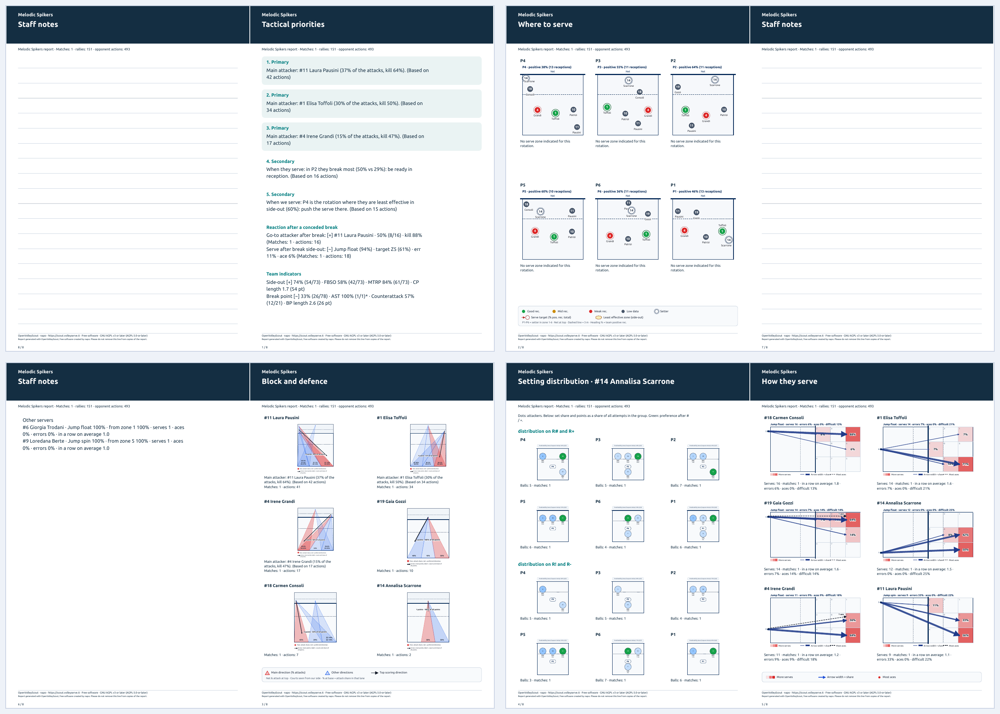
</p>

<p align="center">
  Example made with the demo match:
  <a href="docs/examples/tactical-report-booklet.pdf"><b>download the booklet (PDF)</b></a>
  (four A4 sheets to fold into an A5 booklet) ·
  <a href="docs/examples/tactical-report-a4.pdf"><b>A4 version (PDF)</b></a>
</p>

| | |
|---|---|
| 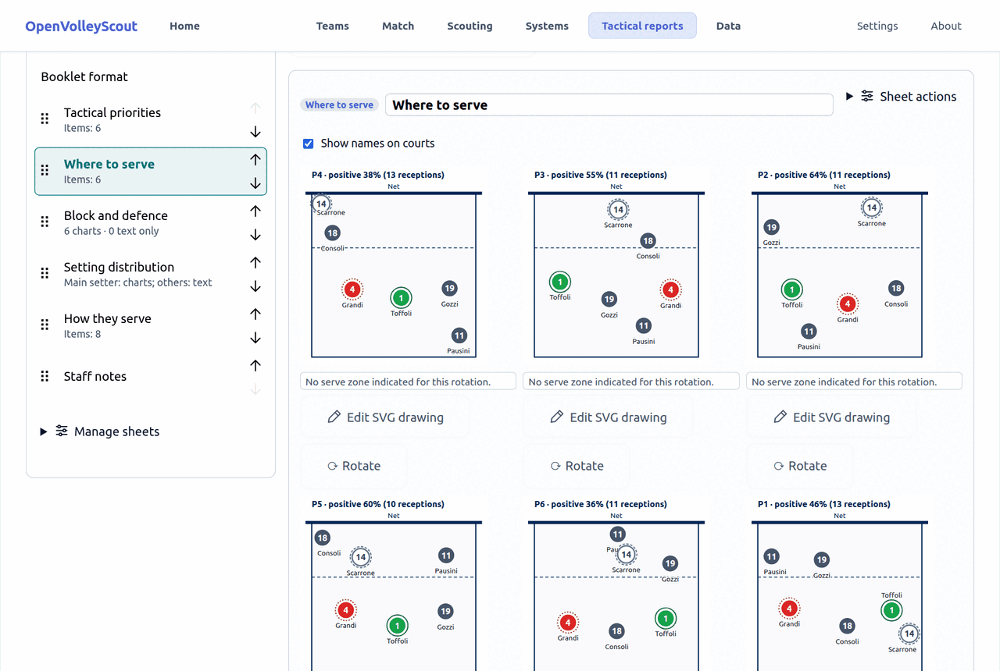<br/>**Where to serve**, rotation by rotation | 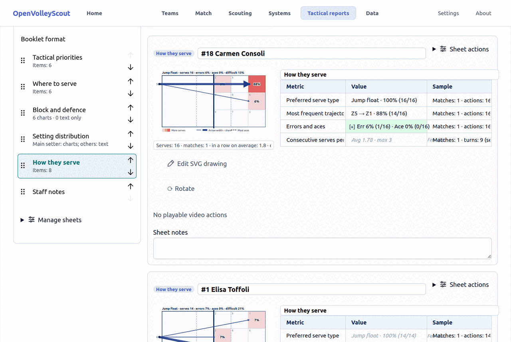<br/>**How they serve**: the main servers on one page |

The booklet brings together tactical priorities, serve targets by rotation,
setting distribution, block and defence, "How they serve" and your own drawing
sheets with players, arrows and areas. Choose the format, reorder or hide the
sheets, then export PDF, PPTX/ODP or SVG.

## Screenshots

| | |
|---|---|
| 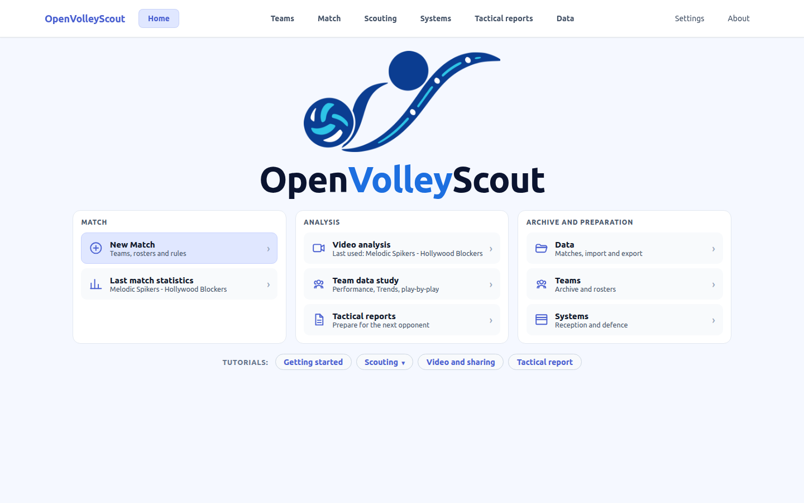<br/>**Home** | 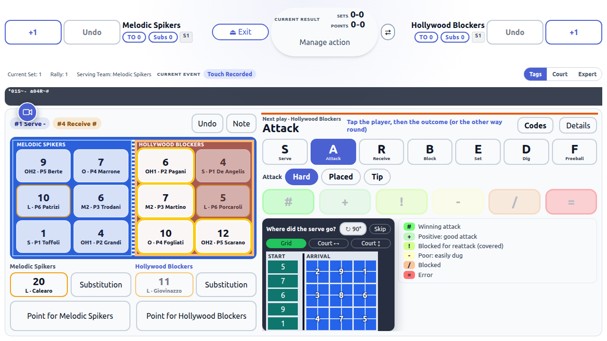<br/>**Tags mode**, also next to the video |
| 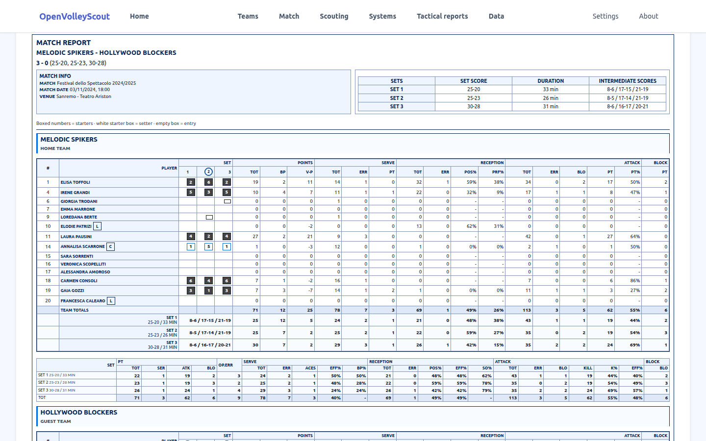<br/>**Match report** | 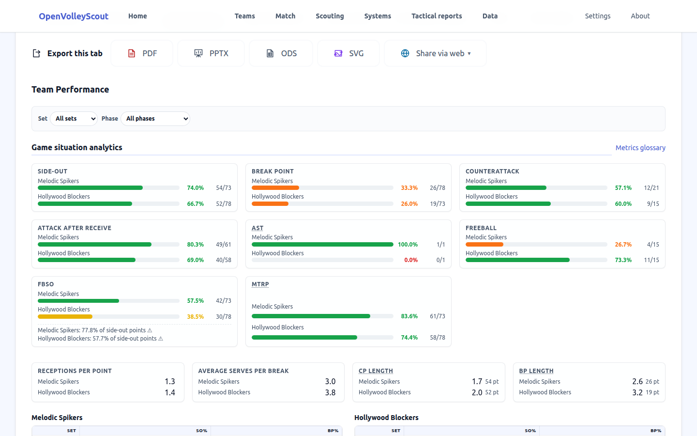<br/>**Team performance** |
| 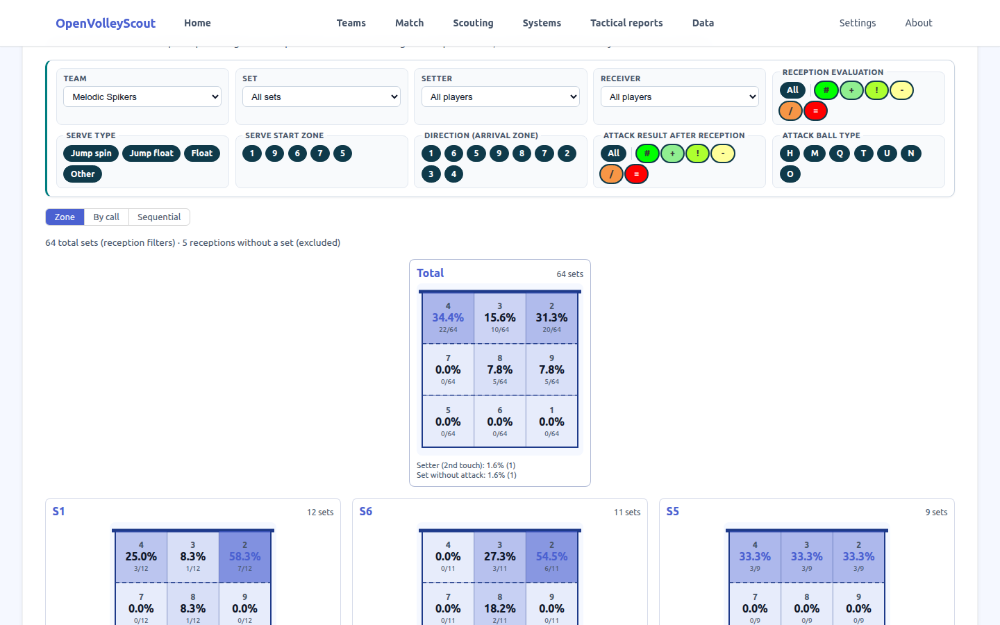<br/>**Side-out study** | 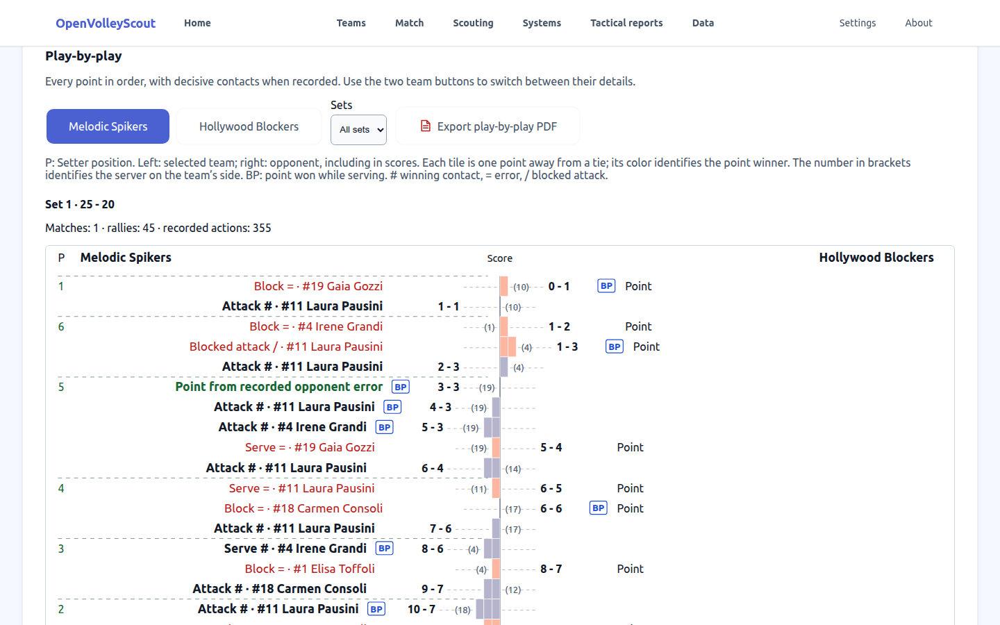<br/>**Play-by-play** |
| 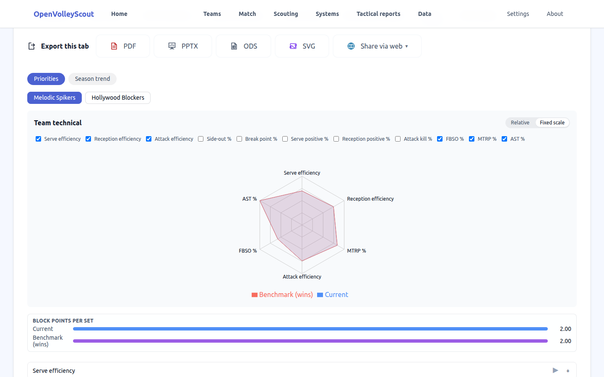<br/>**Trends: priorities** | 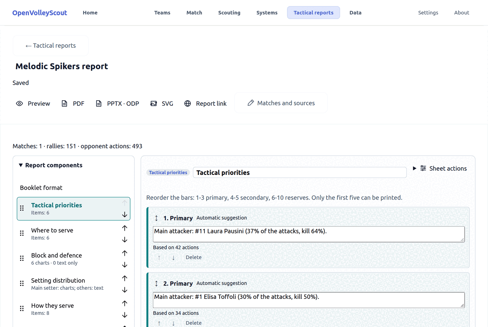<br/>**Tactical report editor** |
| 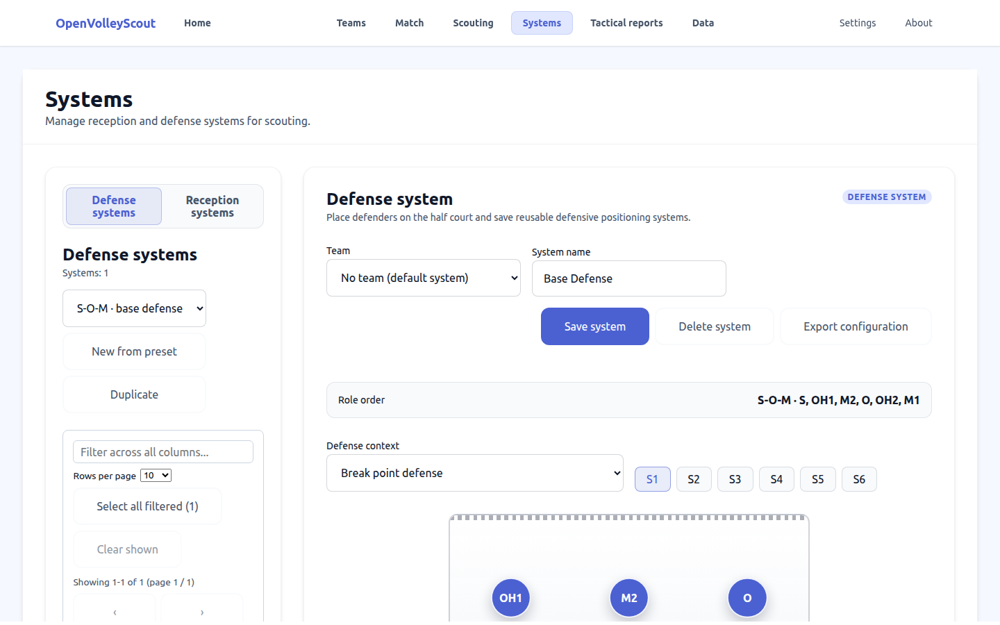<br/>**Reception and defence systems** | 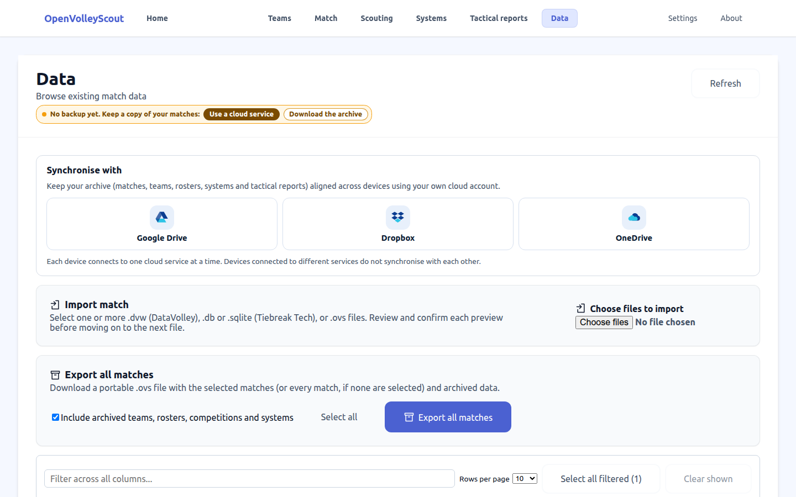<br/>**Data, backup and cloud sync** |

The screenshots use the demo match included in the app (fictional teams).

## Get it

### In the browser

Open **[scout.volleyserve.it](https://scout.volleyserve.it)**: nothing to
install. It is also an installable offline app (PWA): add it to the home
screen of a tablet or phone and it starts without network. New versions are
offered with an "Update now" button, never in the middle of a rally.

**iPhone and iPad:** there is no App Store app. Open the web app in Safari and
choose **Share → Add to Home Screen**.

### Desktop and Android

Download the installer from the
[latest release](https://github.com/napo/openvolleyscout/releases/latest):
Windows, macOS (Apple Silicon and Intel), Linux and Android (APK). The desktop
apps update themselves.

<details>
<summary><b>macOS: the app is not signed by Apple</b></summary>

This free software project has no Apple Developer account, so macOS warns that
the app "cannot be opened" or "is damaged". Whether to run it is your decision.
If you trust the file from the official release page, open it in one of these ways:

- right-click the app → **Open**, then confirm;
- **System Settings → Privacy & Security → Open Anyway** after the first blocked attempt;
- from a terminal: `xattr -dr com.apple.quarantine /Applications/OpenVolleyScout.app`

Automatic updates keep working afterwards.
</details>

## Privacy

OpenVolleyScout has no server of its own. Matches, teams and statistics are
stored on your device; cloud synchronisation is optional and goes straight to
your own cloud, where the app sees only its own folder. Details in the
[privacy policy](https://scout.volleyserve.it/privacy.html).

## Documentation

- [User guide](docs/user-guide.md) and [scouting guide](docs/scouting-guide.md) ([italiano](docs/scouting-guide_it.md))
- [Cloud synchronisation](docs/cloud-sync.md)
- [Shared statistics links](docs/shared-stats-link.md)
- [Documentation index](docs/README.md): architecture, data model, persistence,
  scouting, systems, import/export formats

## Development

Built with React 18, TypeScript and Vite; Tauri 2 for the desktop and Android
apps; Dexie (IndexedDB) for storage; Zustand for state.

```bash
npm install
npm run dev          # web app at http://localhost:5173
npm test             # lint, validation scripts and unit tests
npm run build        # production web build
npm run tauri dev    # desktop app
```

Cloud synchronisation needs OAuth client ids at build time (`.env.local`, see
[docs/cloud-sync.md](docs/cloud-sync.md)); without them the services are shown
as unavailable and everything else works. Start with
[Architecture](docs/architecture.md), [Code structure](docs/code-structure.md)
and [Developer guidelines](docs/developer-guidelines.md).

Bug reports and ideas are welcome in the
[issues](https://github.com/napo/openvolleyscout/issues).

## Acknowledgements

Thanks to everyone who helps improve OpenVolleyScout with suggestions, testing,
and feedback:

- **Fabio d'Amico** - logo design, suggestions, bug reports, and testing
- **Lorenzo Cosentino**, **Luigi Mazzotta**, **Valentina Perghem**,
  **Alessandro Fellin**, **Cataldo Di Michele** - suggestions, bug reports, and
  testing

The logo was designed by Maurizio Napolitano and Fabio d'Amico with the support
of AI tools.

## License

OpenVolleyScout is free software by Maurizio Napolitano, licensed under the
GNU AGPL v3 or later (AGPL-3.0-or-later). You may redistribute and modify it
under version 3 of the GNU Affero General Public License or, at your option,
any later version. See [LICENSE](LICENSE) for the full license text.
