# Tutorial: preparing a tactical report

This tutorial shows, step by step, how to build the tactical report of an
opposing team: from the imported match to the booklet you print and the link
you send to the staff.

The example uses the match **Melodic Spikers - Hollywood Blockers** (file
[`melodicspikers_hollywoodblockers.dvw`](melodicspikers_hollywoodblockers.dvw),
included in the repository) and studies the **Melodic Spikers**, as if they
were the next opponent.

Versione italiana: [tutorial-tactical-reports_it.md](tutorial-tactical-reports_it.md).

## What you need

- OpenVolleyScout, web or desktop.
- At least one match of the team to study, scouted with OVS or imported from
  DataVolley (`.dvw`), Tiebreak Tech (`.db`, `.sqlite`) or `.ovs`.

The more matches you select, the more reliable the numbers: with a single
match, as in this example, many samples are small and OVS marks them.

## 1. Import the match

1. Open **Data** and press **Choose files to import**.
2. Select the `.dvw` file. OVS shows a preview: teams, sets, number of players
   and actions, any errors.
3. Check it and press **Confirm import**.

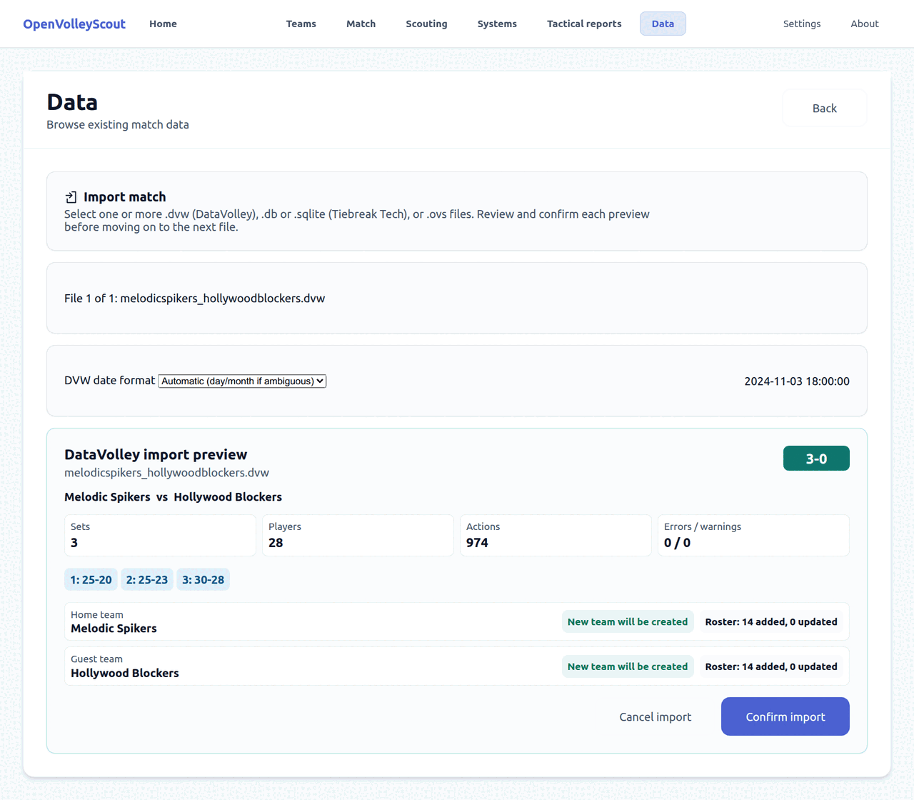

The two teams and their rosters are created in the archive if they do not
exist yet.

## 2. Create the report

Open **Tactical reports** and press **Create tactical report**.

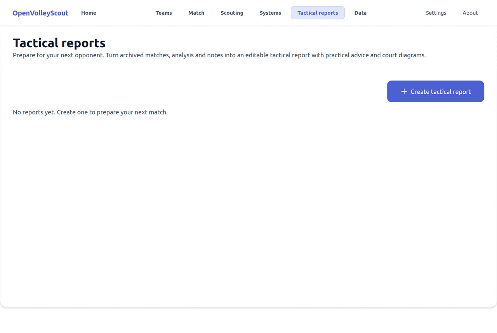

On the page that opens, choose what goes into the report:

1. **Opponent team**: the team to study. Here *Melodic Spikers*.
2. **Competition / season**: OVS proposes the most recent one and preselects
   its matches. **Include matches from other competitions or seasons** lets you
   add more.
3. **Matches**: tick the ones to use. The *Team similarity* column tells how
   much the opponent of that match resembles your own team; it appears when
   the archive holds enough matches to compute it.
4. **Booklet format**: *Compact* (4 pages), *Extended* (8 pages, recommended)
   or *Custom*. The checkboxes below add or remove content (block and defence
   sheet, how they serve, other servers, other setters).

At the bottom you find the sample summary: matches, rallies and opponent
actions.

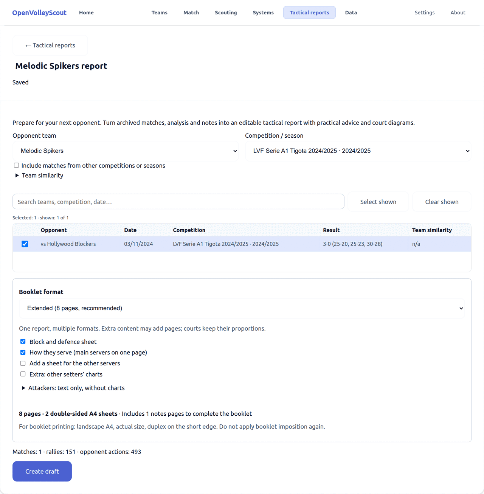

Press **Create draft**: OVS computes the statistics and prepares the sheets.

## 3. The report editor

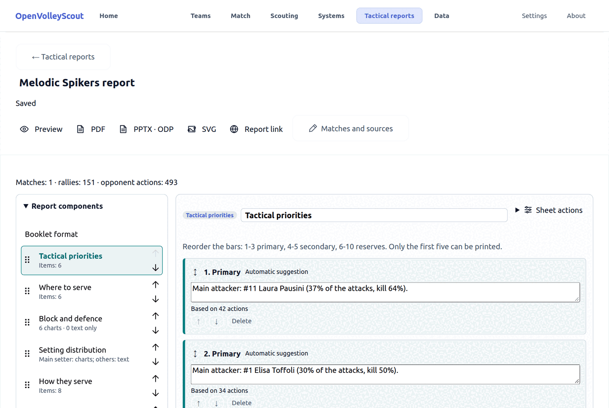

- At the top: the report title (editable), the save status and the commands
  **Preview**, **PDF**, **PPTX · ODP**, **SVG**, **Report link** and
  **Matches and sources** (to go back to the match selection).
- On the left, **Report components**: the list of sheets. Click one to open
  it; drag it or use the arrows to change its order in the booklet. **Manage
  sheets** adds extra sheets, duplicates or deletes.
- On the right: the selected sheet. Every text and every cell can be edited,
  and each sheet ends with its **Sheet notes**.

Changes are saved automatically.

## 4. The sheets

### Tactical priorities

The first page: the instructions for your team. OVS proposes six sentences
(*Automatic suggestion*) with the number of actions they are based on. You can
rewrite, reorder or delete them, or add more with **Add instruction**.

Order matters: the first three are *primary*, the fourth and fifth
*secondary*, from the sixth on *reserves*. At most the first five are printed.

Below you find the **Team indicators** (side-out, FBSO, break point,
counter-attack...) with their meaning.

### Where to serve

One court for each rotation of the opponent, P1 to P6, with the receivers
coloured by quality: green good reception, yellow intermediate, red weak, grey
not enough data. The setter has a dashed ring. The title of each court gives
the team's positive reception in that rotation.

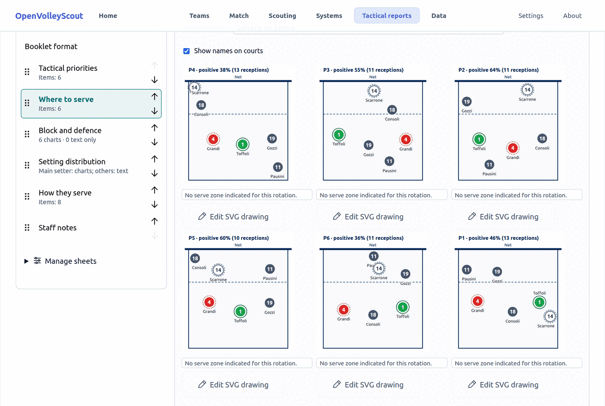

### Block and defence

One card for each main attacker: the fans show the attack directions (red is
the preferred one), the arrow the direction that scores most, and the table
the efficiency overall, after reception, after dig and in the hardest
situation.

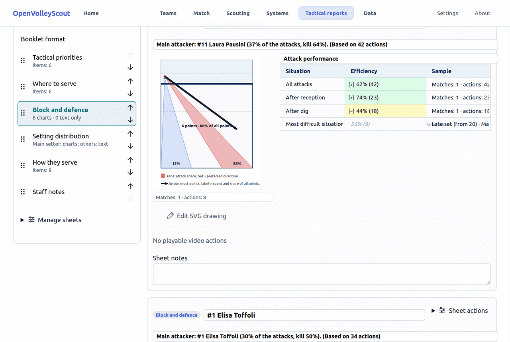

### Setting distribution

For each rotation, who the setter sets and how often. There are two series:
after a good reception (R# and R+) and after a difficult one (R! and R-). The
most used option is green; above each court, *predictability* is how often
the most frequent choice is made.

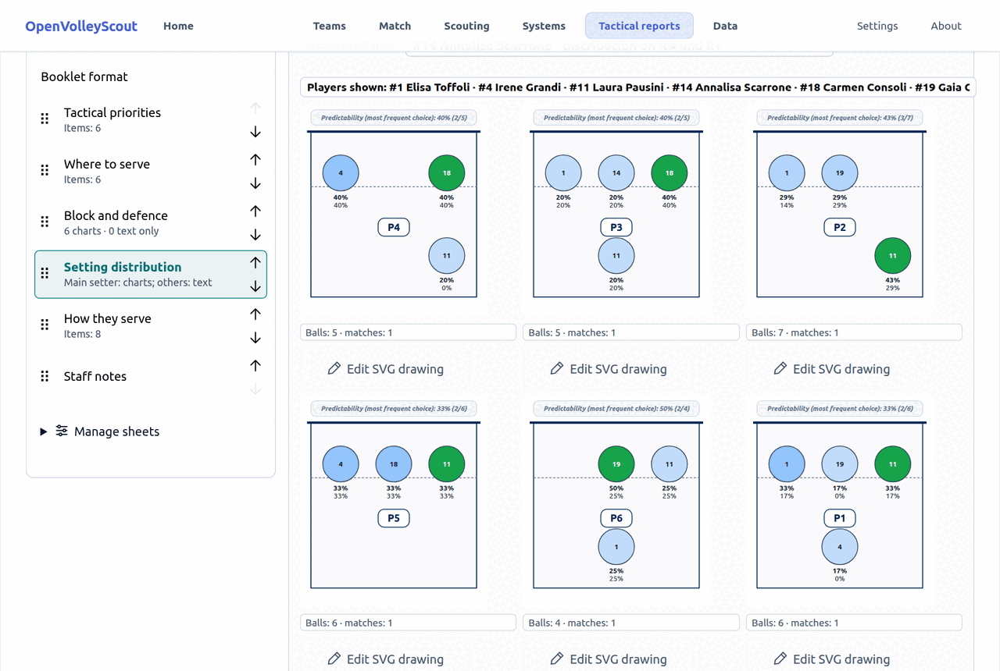

### How they serve

One card for each server: prevailing serve type, most frequent trajectory,
errors and aces, and how many serves in a row they usually make.

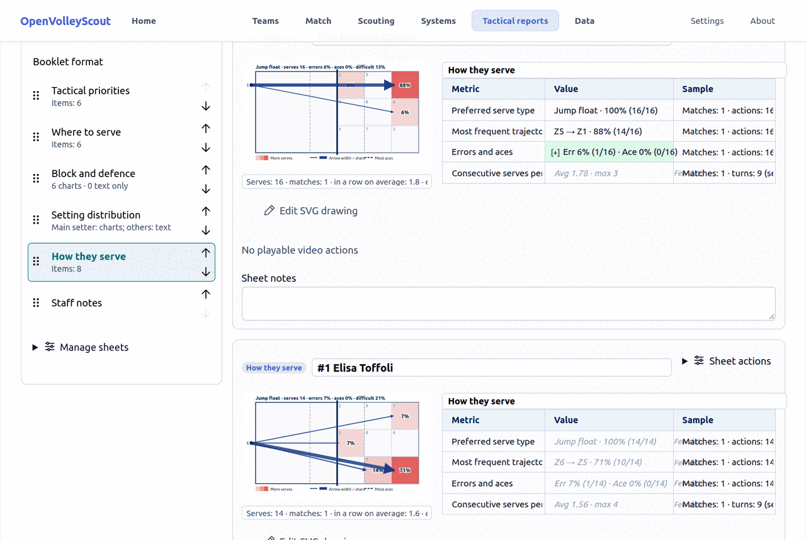

### Staff notes

A free sheet for notes. In the booklet, leftover pages become lined pages for
handwriting.

## 5. Edit the drawings

Under each court there is **Edit SVG drawing**. The editor opens: you can move
the players, add arrows (straight or curved), areas, cones and text, change
colours and thickness in the *Properties* panel, undo and redo.

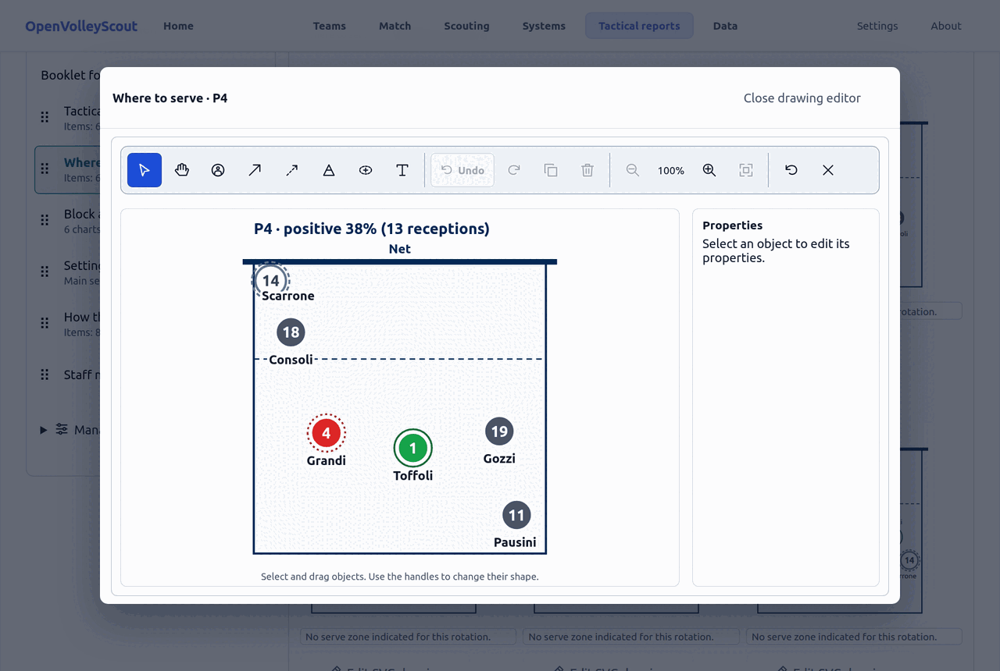

Press **Close drawing editor** to go back to the sheet. Your changes stay even
if you later change the selected matches.

## 6. Preview, print and export

- **Preview → A4 / Booklet** shows the pages at the bottom of the screen.
- **PDF → A4 / Booklet** downloads the file ready to print.
- **PPTX · ODP** exports an editable presentation (PowerPoint or
  OpenDocument).
- **SVG** downloads a ZIP with one vector file per page.

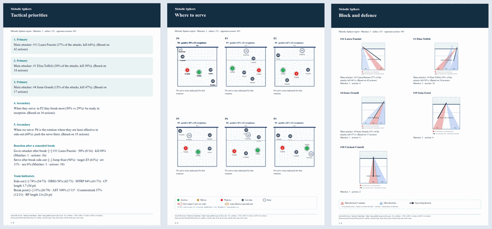

To print the booklet: A4 landscape, actual size, double-sided on the short
edge. Do not use the printer's "booklet" function: the pages are already
imposed.

## 7. Share the report with a link

1. Press **Report link**.
2. Choose the **Link validity** in days.
3. Press **Create web link** and copy the link.

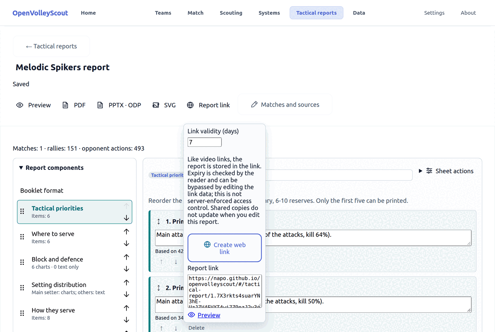

Whoever receives the link opens it in the browser, on a phone too, without
installing OVS and without your data: they see the sheets and can zoom them.

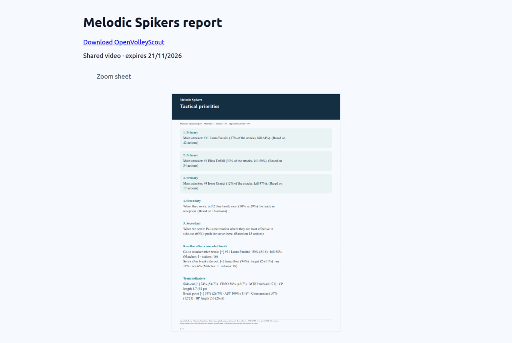

Good to know:

- The report is contained in the link, not on a server. The expiry is checked
  by the page that opens it: it is not access control.
- A shared copy does not update: if you edit the report, create a new link.

## 8. Videos of the actions

If the matches of the report have a synchronized YouTube video (see the
[video synchronization tutorial](tutorial-video-sync.md)), the cards of
attackers, receivers and servers can carry a link, and in the booklet a QR
code, that plays their actions. With local videos or no video you get "No
playable video actions", as in the pictures of this tutorial.

## In short

1. **Data** → import the opponent's matches.
2. **Tactical reports** → **Create tactical report** → choose team, matches
   and format → **Create draft**.
3. Review the priorities, check the sheets, adjust the drawings.
4. **Preview**, then **PDF** to print or **Report link** to share it.
