# Tutorial: preparare un report tattico

Questo tutorial mostra, passo per passo, come costruire il report tattico di una
squadra avversaria: dalla partita importata al fascicolo da stampare e al link
da mandare allo staff.

L'esempio usa la gara **Melodic Spikers - Hollywood Blockers** (file
[`melodicspikers_hollywoodblockers.dvw`](melodicspikers_hollywoodblockers.dvw),
incluso nel repository) e studia le **Melodic Spikers**, come se fossero la
prossima avversaria.

English version: [tutorial-tactical-reports.md](tutorial-tactical-reports.md).

## Cosa serve

- OpenVolleyScout, versione web o desktop.
- Almeno una partita della squadra da studiare, rilevata con OVS oppure
  importata da DataVolley (`.dvw`), Tiebreak Tech (`.db`, `.sqlite`) o `.ovs`.

Più partite selezioni, più i numeri del report sono affidabili: con una sola
gara, come in questo esempio, molti campioni sono piccoli e OVS lo segnala.

## 1. Importa la partita

1. Apri **Dati** e premi **Scegli i file da importare**.
2. Seleziona il file `.dvw`. OVS mostra un'anteprima: squadre, set, numero di
   atleti e di azioni, eventuali errori.
3. Controlla e premi **Conferma import**.

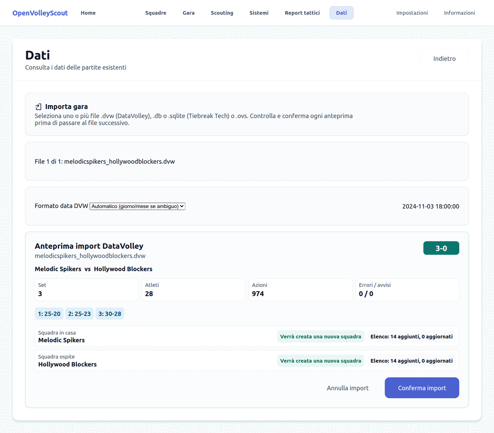

Le due squadre e le rose vengono create nell'archivio, se non esistono già.

## 2. Crea il report

Apri **Report tattici** e premi **Crea report tattico**.

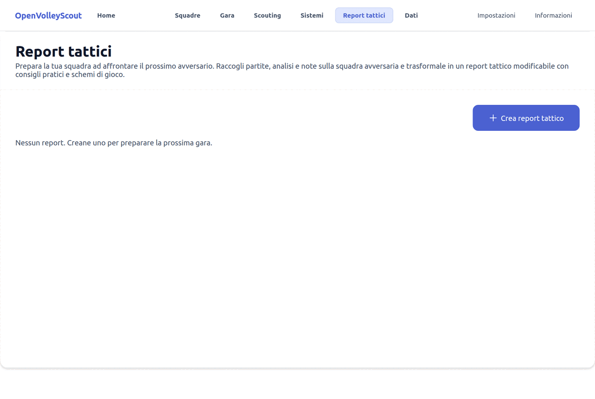

Nella pagina che si apre scegli che cosa entra nel report:

1. **Squadra avversaria**: la squadra da studiare. Qui *Melodic Spikers*.
2. **Campionato / stagione**: OVS propone il più recente e preseleziona le sue
   partite. Con **Includi partite di altri campionati o stagioni** puoi
   aggiungerne altre.
3. **Partite**: spunta quelle da usare. La colonna *Similarità tra le squadre*
   indica quanto l'avversaria di quella gara assomiglia alla tua squadra;
   compare quando in archivio ci sono abbastanza partite per calcolarla.
4. **Formato booklet**: *Compatto* (4 pagine), *Esteso* (8 pagine, consigliato)
   o *Personalizzato*. Le caselle sotto aggiungono o tolgono contenuti (foglio
   muro e difesa, come battono, altri battitori, altri palleggiatori).

In fondo trovi il riepilogo del campione: partite, scambi e azioni
dell'avversaria.

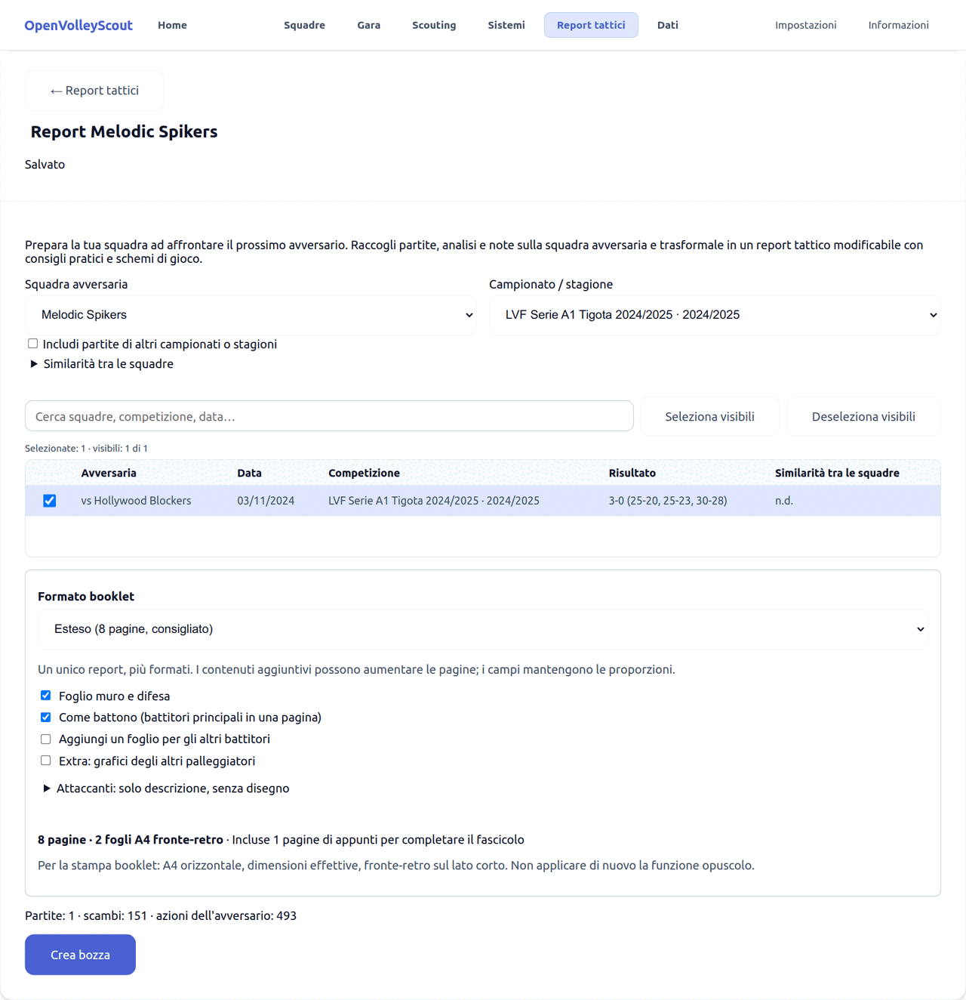

Premi **Crea bozza**: OVS calcola le statistiche e prepara i fogli.

## 3. L'editor del report

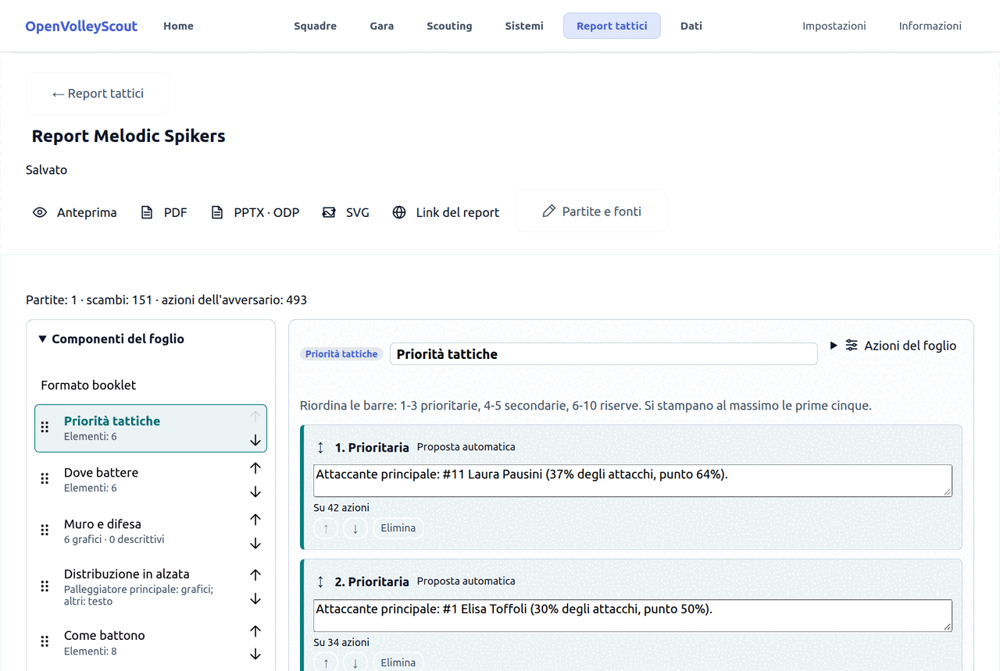

- In alto: titolo del report (modificabile), stato di salvataggio e i comandi
  **Anteprima**, **PDF**, **PPTX · ODP**, **SVG**, **Link del report** e
  **Partite e fonti** (per tornare alla scelta delle partite).
- A sinistra, **Componenti del foglio**: l'elenco dei fogli. Cliccane uno per
  aprirlo; trascinalo o usa le frecce per cambiarne l'ordine nel fascicolo.
  **Gestisci fogli** aggiunge fogli extra, duplica o elimina.
- A destra: il foglio selezionato. Ogni testo e ogni cella è modificabile, e
  ogni foglio ha in fondo una **Nota del foglio**.

Le modifiche si salvano da sole.

## 4. I fogli

### Priorità tattiche

È la prima pagina: le indicazioni da dare alla squadra. OVS propone sei frasi
(*Proposta automatica*) con il numero di azioni su cui si basano. Puoi
riscriverle, riordinarle, eliminarle o aggiungerne con **Aggiungi
indicazione**.

L'ordine conta: le prime tre sono *prioritarie*, la quarta e la quinta
*secondarie*, dalla sesta in poi *riserve*. Si stampano al massimo le prime
cinque.

Sotto trovi gli **Indicatori di squadra** (cambio-palla, FBSO, break point,
contrattacco...) con il loro significato.

### Dove battere

Un campo per ogni rotazione dell'avversaria, da P1 a P6, con chi riceve
colorato in base alla qualità: verde ricezione buona, giallo
intermedia, rosso debole, grigio dati insufficienti. Il palleggiatore ha un
anello tratteggiato. Il titolo di ogni campo riporta la ricezione positiva di
squadra in quella rotazione.

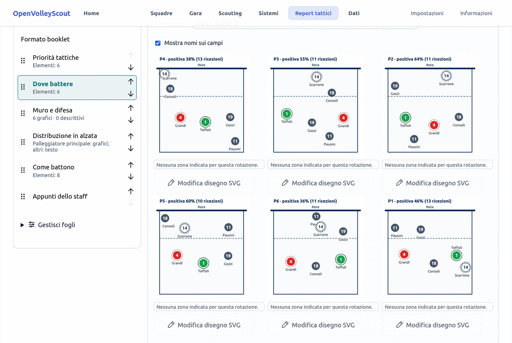

### Muro e difesa

Una scheda per ogni attaccante principale: i ventagli mostrano le direzioni
d'attacco (in rosso la preferita), la freccia la direzione che fa più punti, e
la tabella l'efficienza in tutte le situazioni, dopo ricezione, dopo difesa e
nella situazione più difficile.

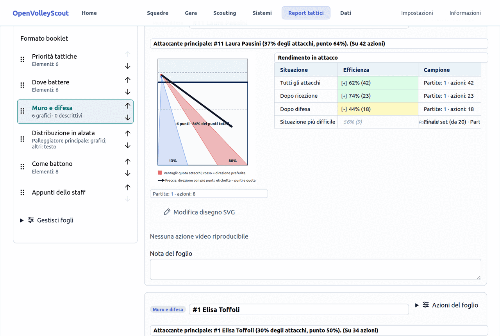

### Distribuzione in alzata

Per ogni rotazione, a chi alza il palleggiatore e con quale frequenza. Ci sono
due serie: dopo ricezione buona (R# e R+) e dopo ricezione difficile (R! e
R-). In verde l'opzione più usata; sopra ogni campo la *prevedibilità*, cioè
quanto spesso viene fatta la scelta più frequente.

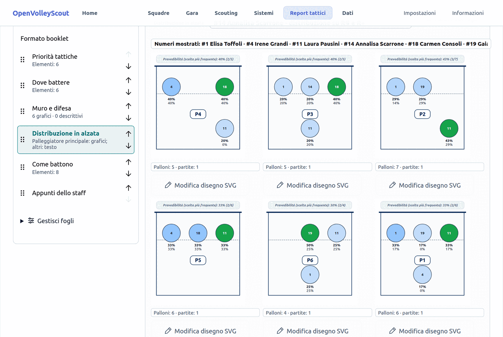

### Come battono

Una scheda per ogni atleta al servizio: tipo di battuta prevalente, traiettoria più
frequente, errori e ace, e quante battute consecutive fa di solito.

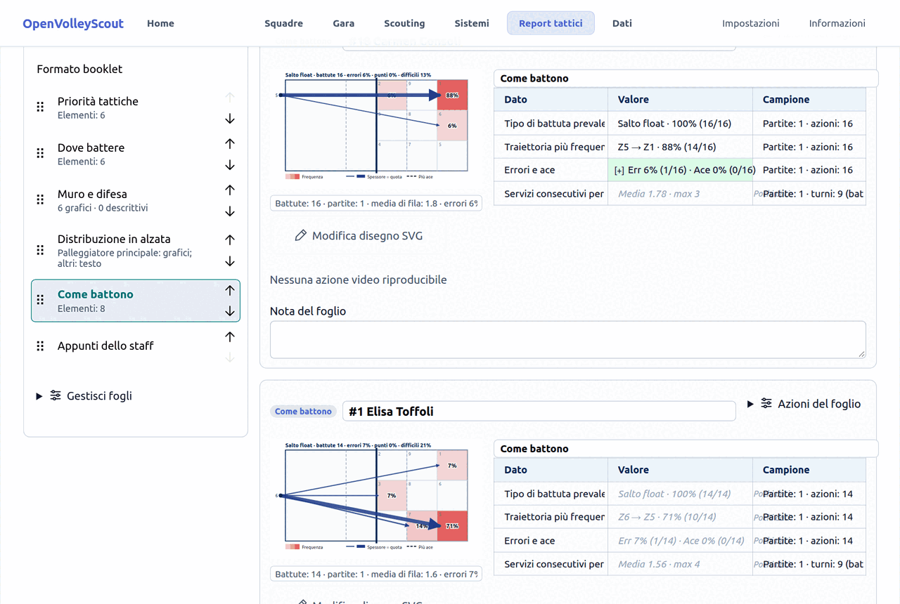

### Appunti dello staff

Un foglio libero per le note. Nel booklet le pagine che avanzano diventano
pagine rigate per gli appunti.

## 5. Modifica i disegni

Sotto ogni campo c'è **Modifica disegno SVG**. Si apre l'editor: puoi spostare
i segnaposto delle atlete e degli atleti, aggiungere frecce (dritte o curve), zone, coni e testi, cambiare
colori e spessori dal pannello *Proprietà*, annullare e ripetere.

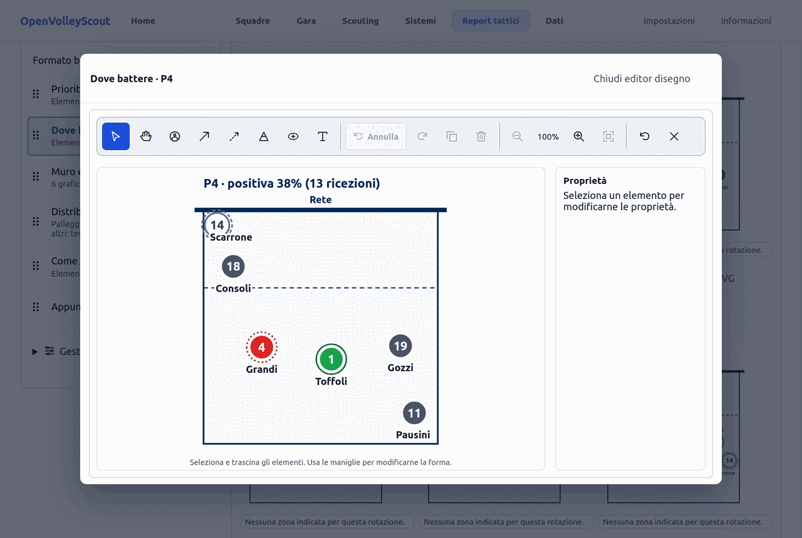

Premi **Chiudi editor disegno** per tornare al foglio. Le modifiche restano
anche se in seguito cambi le partite selezionate.

## 6. Anteprima, stampa ed esportazione

- **Anteprima → A4 / Booklet** mostra le pagine in fondo alla schermata.
- **PDF → A4 / Booklet** scarica il file pronto da stampare.
- **PPTX · ODP** esporta una presentazione modificabile (PowerPoint o
  OpenDocument).
- **SVG** scarica uno ZIP con un file vettoriale per pagina.

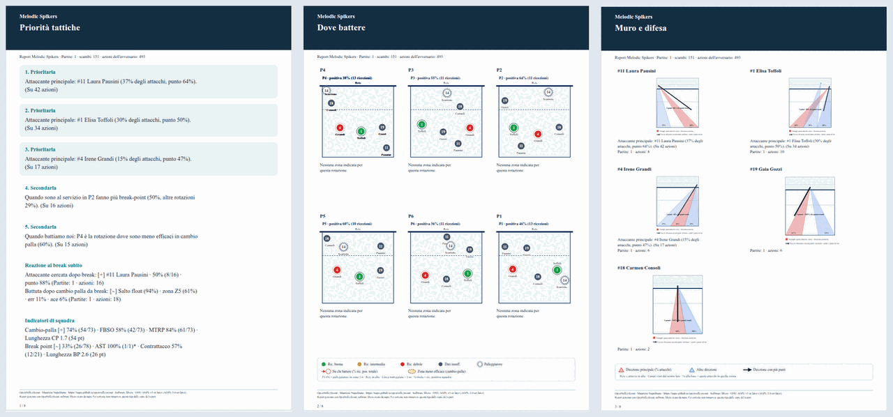

Per stampare il booklet: foglio A4 orizzontale, dimensioni effettive,
fronte-retro sul lato corto. Non usare la funzione "opuscolo" della stampante:
le pagine sono già impostate.

## 7. Condividi il report con un link

1. Premi **Link del report**.
2. Scegli la **Validità del link** in giorni.
3. Premi **Crea link web** e copia il link.

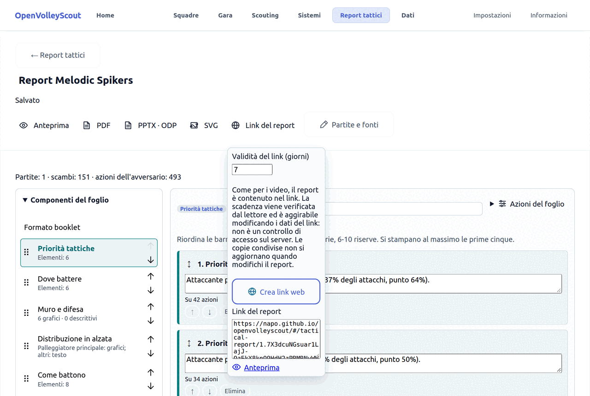

Chi riceve il link lo apre nel browser, anche dal telefono, senza installare
OVS e senza avere i tuoi dati: vede i fogli e può ingrandirli.

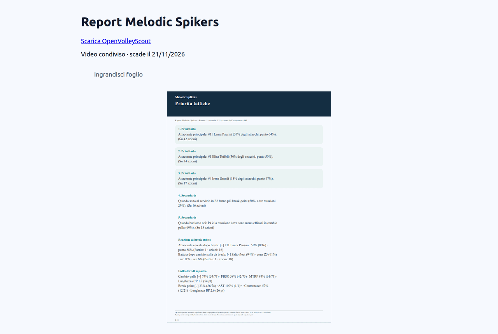

Da sapere:

- Il report è contenuto nel link, non su un server. La scadenza viene
  controllata dalla pagina che lo apre: non è una protezione d'accesso.
- Una copia condivisa non si aggiorna: se modifichi il report, crea un nuovo
  link.

## 8. Video delle azioni

Se le partite del report hanno un video YouTube sincronizzato (vedi il
[tutorial sulla sincronizzazione video](tutorial-video-sync_it.md)), le schede
di attacco, ricezione e battuta possono avere un link, e nel booklet un
codice QR, che riproduce le loro azioni. Con video locali o senza video compare
"Nessuna azione video riproducibile", come nelle immagini di questo tutorial.

## In breve

1. **Dati** → importa le partite dell'avversaria.
2. **Report tattici** → **Crea report tattico** → scegli squadra, partite e
   formato → **Crea bozza**.
3. Rivedi le priorità, controlla i fogli, sistema i disegni.
4. **Anteprima**, poi **PDF** per la stampa o **Link del report** per
   condividerlo.
