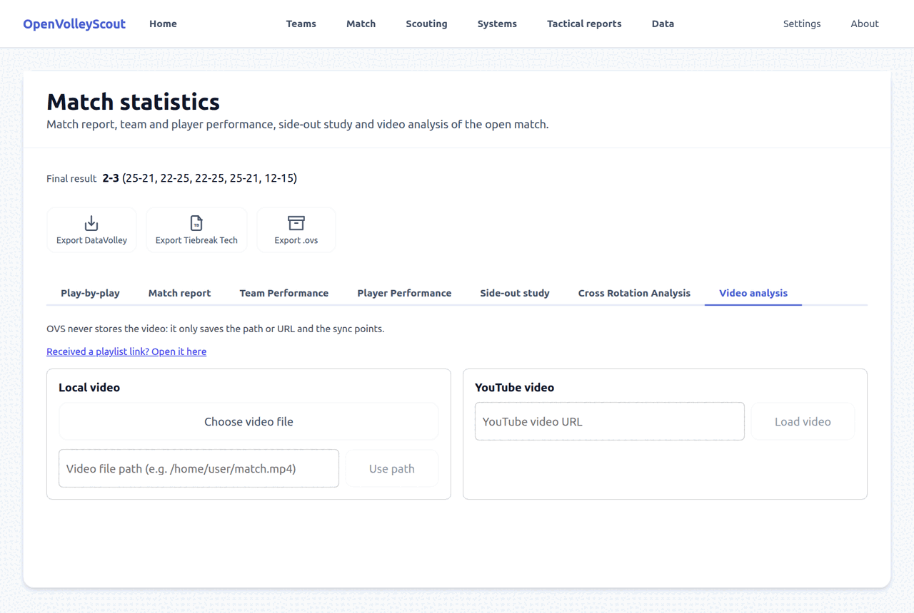
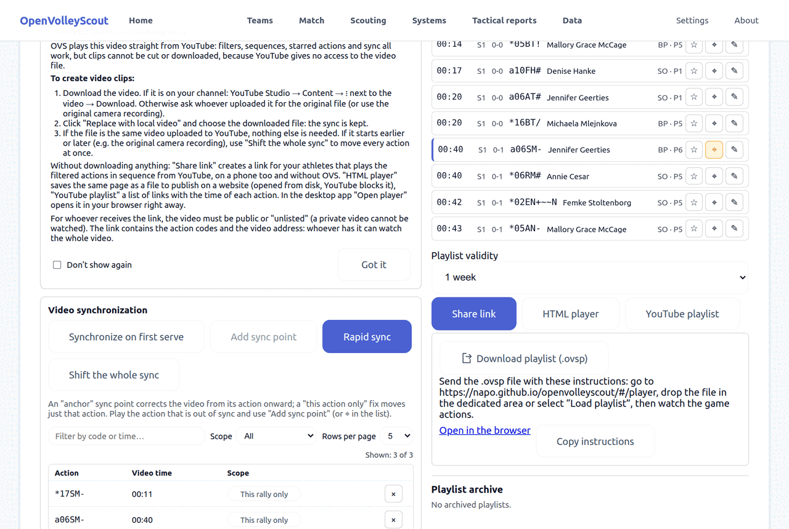
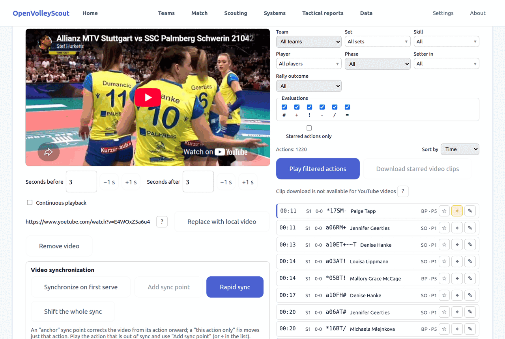
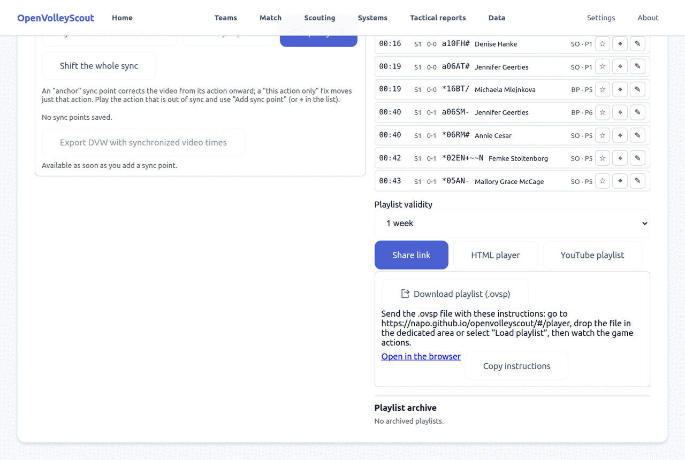
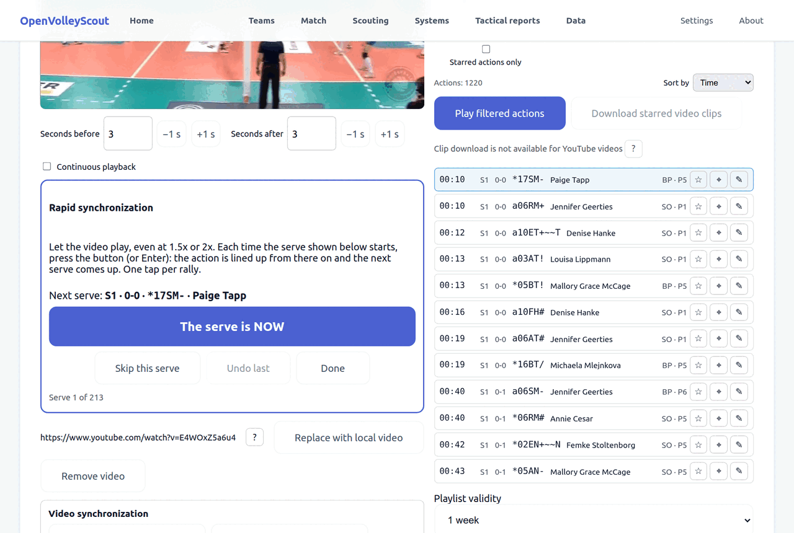
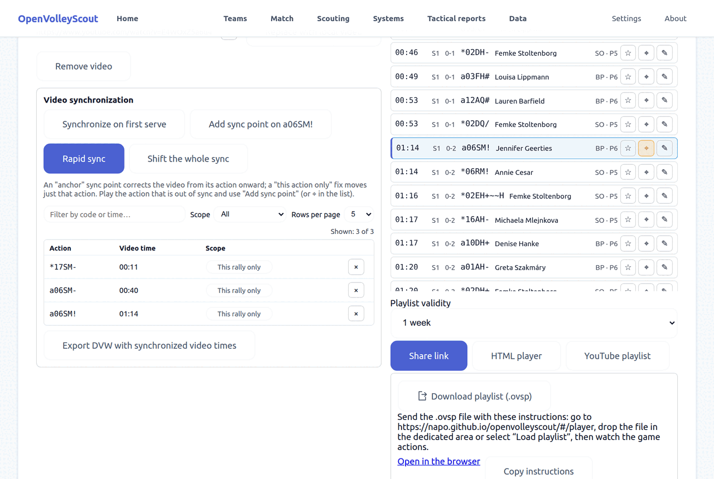
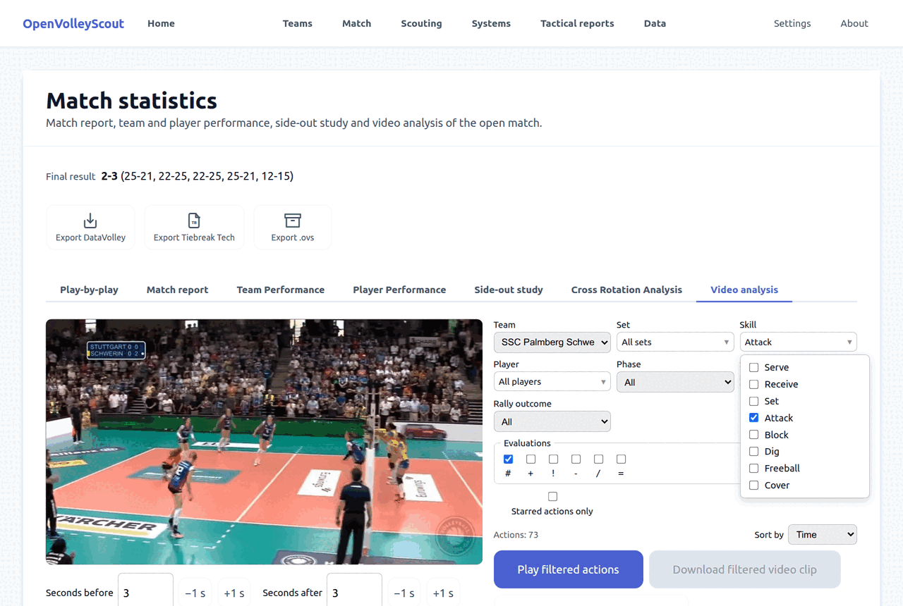
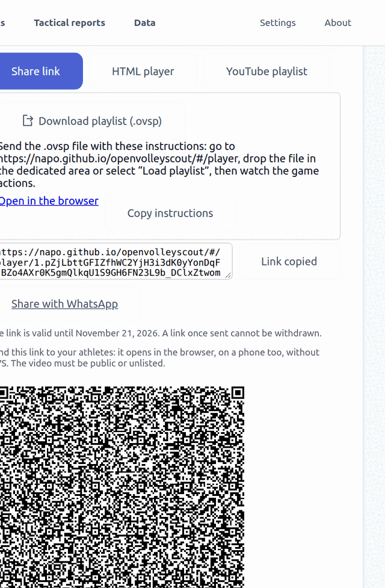
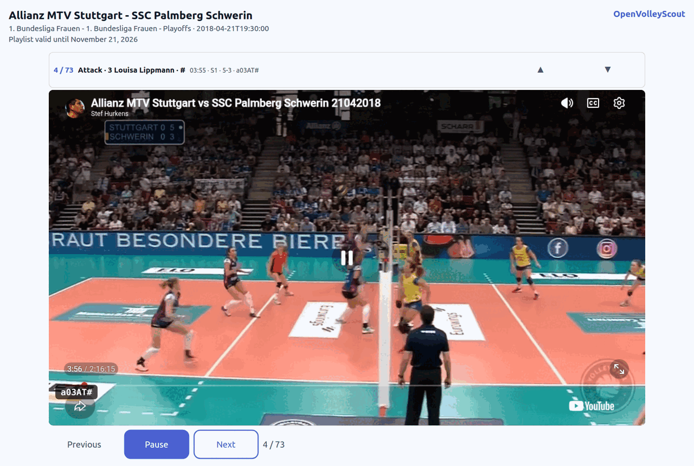
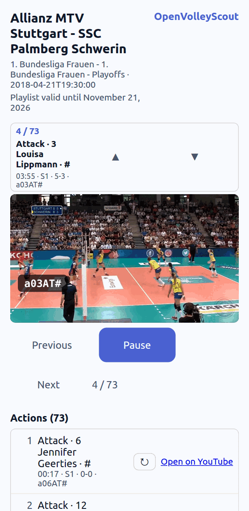

# Tutorial: synchronizing the video and sharing the actions

This tutorial shows how to attach the video of a match, line it up with the
scouted actions, filter what matters and send it to the team with a link that
opens in the web player, with nothing to install.

The example uses the match **Allianz MTV Stuttgart - SSC Palmberg Schwerin**
(file [`stuttgart-schwrein.dvw`](../stuttgart-schwrein.dvw), included in the
repository) and its public YouTube video:
`https://www.youtube.com/watch?v=E4WOxZ5a6u4`.

Versione italiana: [tutorial-video-sync_it.md](tutorial-video-sync_it.md).

## What you need

- OpenVolleyScout, web or desktop.
- A match scouted with OVS or imported.
- The video of the match: a file on your computer or a YouTube video.

To share the actions with a link you need a **public** or **unlisted** YouTube
video: a private video cannot be seen.

## 1. Import the match and open the video analysis

1. In **Data** press **Choose files to import**, select the `.dvw` and press
   **Confirm import**.
2. Still in **Data**, press **Match statistics** on the match.
3. Open the **Video analysis** tab.

## 2. Attach the video

You can choose between:

- **Local video → Choose video file**: a file on your computer.
- **Video file path**: useful in the desktop app.
- **YouTube video**: paste the address and press **Load video**.

OVS does not copy the video: it only saves the path or address and the sync
points.

With a YouTube video a guide appears: the video is streamed, so filters,
sequences, stars and synchronization work, but clips cannot be cut and
downloaded. Clips need the file: **Replace with local video** attaches it
without losing the synchronization.

## 3. The screen

- On the left the video, with **Seconds before** and **Seconds after**: how
  much video to show around each action.
- On the right the filters and, below, the list of actions with their time in
  the video. Clicking an action jumps the video there.
- On each row: ☆ stars the action, ⌖ adds a sync point on it, ✎ corrects the
  code.

## 4. Check the alignment

Click a few actions in different parts of the match and see whether the video
starts where it should. There are three cases.

- **DataVolley file with video times** (like the one in this example): the
  actions already have their second and often there is nothing to do. If the
  start of the video was trimmed, one sync point or **Shift the whole sync**
  is enough.
- **Match scouted live**: the recorded times follow the match. Synchronize on
  the first serve and correct where needed.
- **Match scouted from a video**, with pauses and rewinds: the recorded times
  do not follow the match. OVS recognizes it and tells you: use rapid
  synchronization, one tap per rally (see step 6).

## 5. Sync points

- **Synchronize on first serve**: bring the video to the moment of the first
  serve and confirm. This is the starting point when the match has no video
  times.
- **Add sync point**: select an action that is off, bring the video to the
  right moment and confirm. ⌖ on the action's row does the same.

Each point has a scope, which you can change with the button in the table:

| Scope | What it does |
|---|---|
| **From here on** | Corrects that action and all the following ones, up to the next point. |
| **This action only** | Moves just that action. |
| **This rally only** | Corrects the rally of that action, without touching the later ones. |

## 6. Rapid synchronization

When the gap changes from one rally to the next, correcting one point at a
time takes too long. Press **Rapid sync**.

1. Let the video play, even at 1.5x or 2x.
2. The **next serve** appears under the video. When you see it start, press
   **The serve is NOW** (or Enter).
3. OVS lines up that rally and proposes the next serve.
4. **Skip this serve** if a rally is not in the video, **Undo last** if you
   pressed at the wrong moment, **Done** to close.

It starts from the rally of the selected action, or from where you left off.

The taps appear in the sync points table, and the list of actions updates
immediately.

What each tap does depends on the match:

- if the match already has a reliable base (DataVolley video times, or scouted
  live and already synchronized), the tap applies to **that rally only**, as
  in the picture;
- if the match was scouted from a video, the tap applies **from there on**:
  rallies not tapped yet follow the nearest tap before them.

### Matches scouted from a video

On these matches OVS shows a notice and:

- picks the realistic **Intra-rally timing** by itself: reception, set and
  attack are placed 1, 2 and 3 seconds after the serve instead of at the
  typing times. You can change the choice in the menu;
- marks with `≈` the time of the actions of rallies that have no sync point
  yet: there the time is only an estimate.

The advice is one tap per rally.

### Shift the whole sync

Moves all the actions together by the same number of seconds. Use it when you
change video, for example from YouTube to the original file that starts a few
seconds earlier.

## 7. Filter and review

You can filter by team, set, skill, player, phase (break point or side-out),
setter position, rally outcome and evaluation. In the picture: Schwerin's
kills (`#` attacks), 73 actions.

- **Play filtered actions** plays them one after the other.
- **Continuous playback** does not stop the video at the end of each action.
- **Starred actions only** shows the ones you marked with ☆.

## 8. Share the actions

With a YouTube video, below the list you find the commands to share the
filtered actions.

1. Choose the **Playlist validity** (from one day to "never").
2. Press **Share link**.
3. Copy the link, send it with **Share with WhatsApp** or use the **QR code**
   (which can also be downloaded as an image).

The alternatives:

- **HTML player** saves the same page as a file to publish on a website.
- **YouTube playlist** saves a list of links with the minute of each action.
- **Download playlist (.ovsp)** creates a file to send when the link is too
  long: the recipient opens it from the player page.
- **Playlist archive** keeps playlists with a title, to create the link again
  later.

Good to know:

- The playlist is contained in the link: it holds the action codes and the
  video address. Whoever has the link can watch the whole video.
- A link that was sent cannot be withdrawn.
- With many actions the link gets long and some apps cut it: choose fewer
  actions or use the `.ovsp` file or the HTML player.

## 9. The web player

Whoever receives the link opens it in the browser: no OVS, no account.

- The actions play in sequence, each with its code, player and score.
- **Previous**, **Pause** and **Next** to move around; below, the full list to
  jump to an action or repeat it, and **Open on YouTube**.

It works on a phone too:

If you received a link and want to open it from OVS, use **Received a playlist
link? Open it here** in the Video analysis tab, or the `/player` page.

## 10. Other outputs

- **Export DVW with synchronized video times**: saves a DataVolley file with
  the corrected times, to use in other software.
- **Download clips**: with a local video you can export the clips of the
  filtered or starred actions.
- **Tactical reports** use the same synchronization for the video links of
  individual players: see the
  [tactical reports tutorial](tutorial-tactical-reports.md).

## In short

1. **Data** → **Match statistics** → **Video analysis**.
2. Attach the file or the YouTube video.
3. Check a few actions. If needed: **Synchronize on first serve**, then
   **Rapid sync** with one tap per rally.
4. Filter the actions and press **Share link**.
