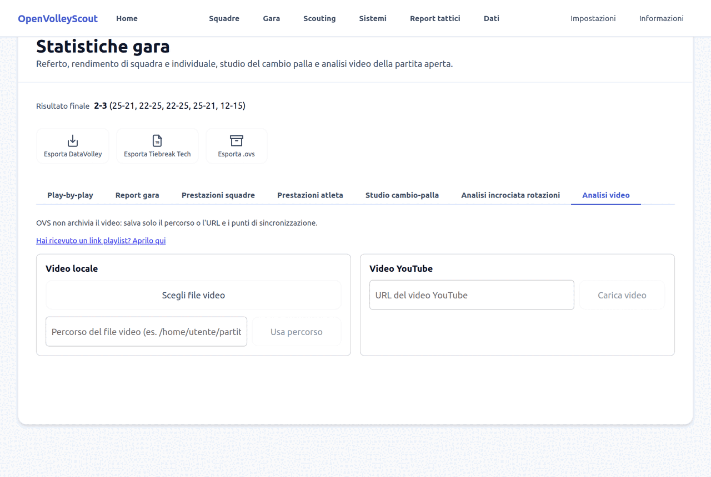
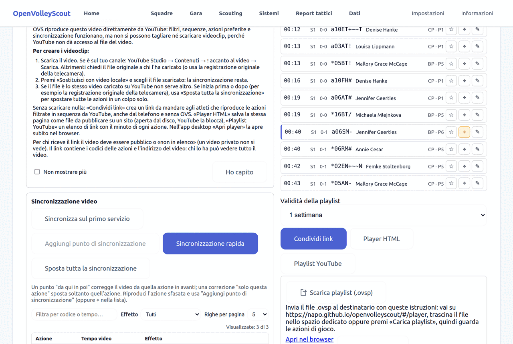
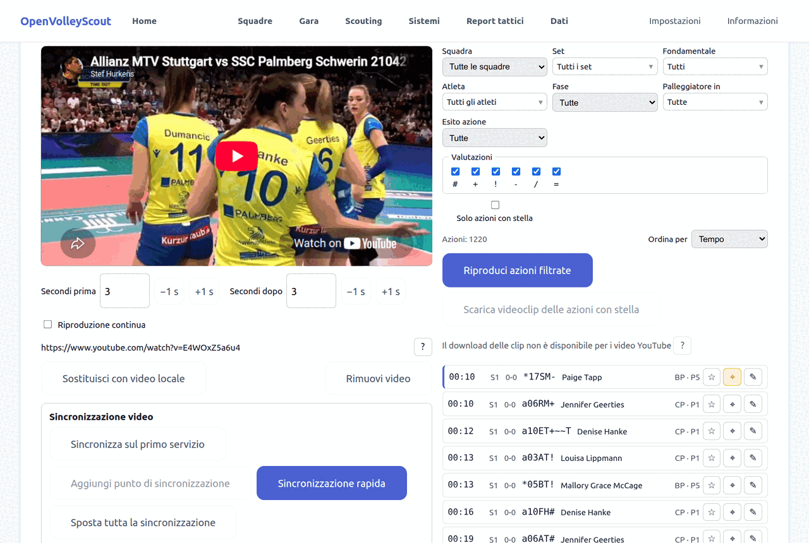
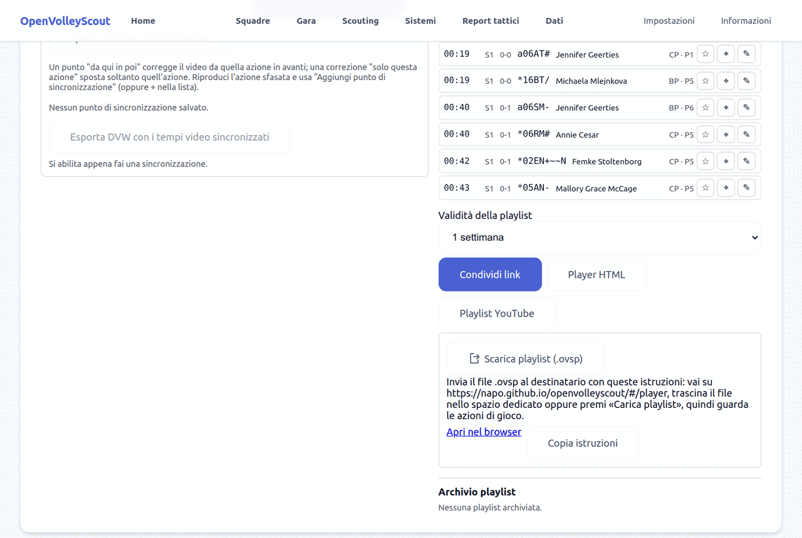
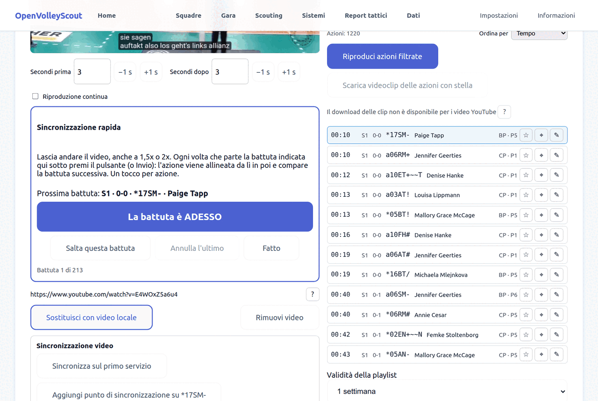
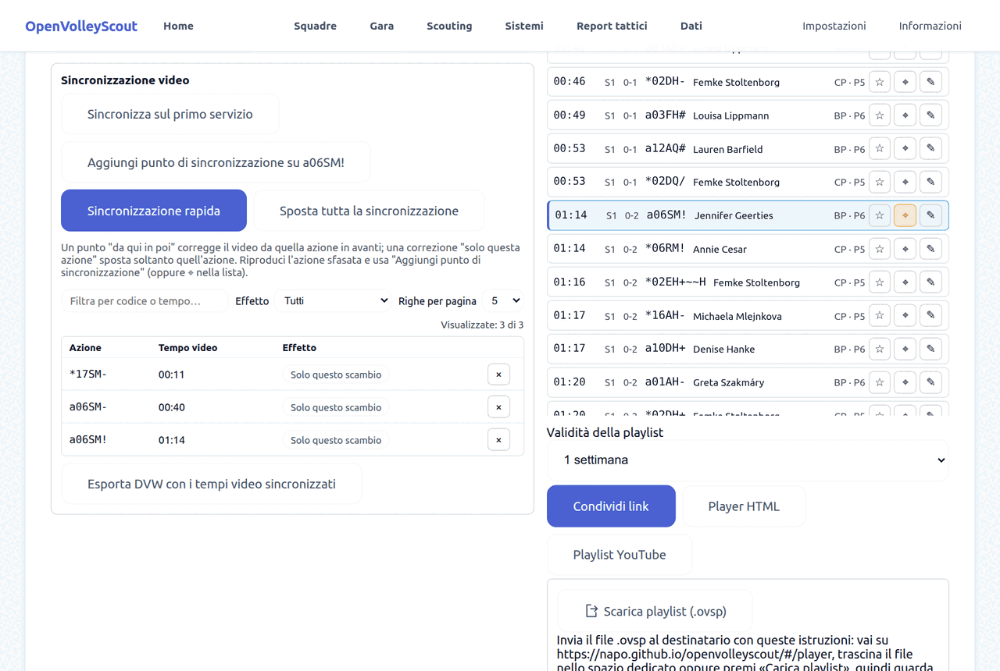
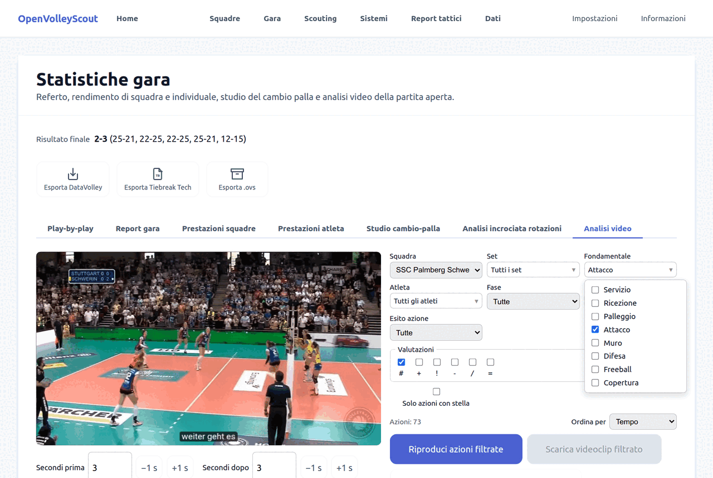
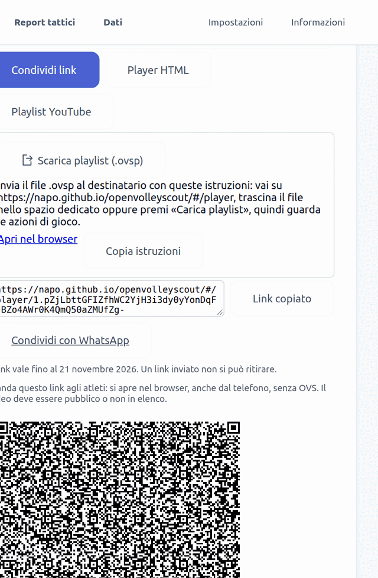
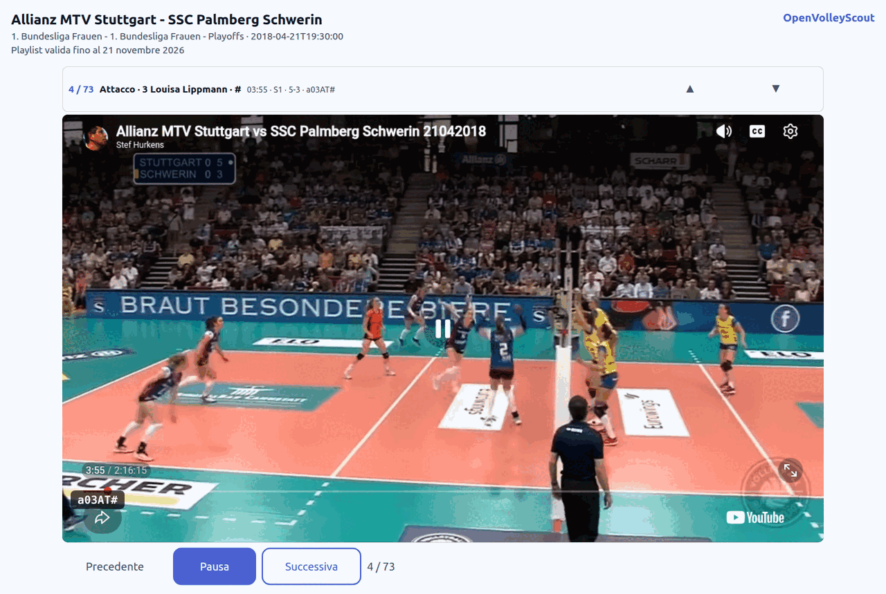
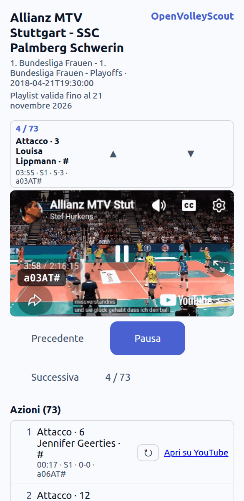

# Tutorial: sincronizzare il video e condividere le azioni

Questo tutorial mostra come collegare il video di una partita, allinearlo alle
azioni rilevate, filtrare quello che interessa e mandarlo alla squadra con un
link che si apre nel player web, senza installare nulla.

L'esempio usa la gara **Allianz MTV Stuttgart - SSC Palmberg Schwerin** (file
[`stuttgart-schwrein.dvw`](../stuttgart-schwrein.dvw), incluso nel repository)
e il suo video pubblico su YouTube:
`https://www.youtube.com/watch?v=E4WOxZ5a6u4`.

English version: [tutorial-video-sync.md](tutorial-video-sync.md).

## Cosa serve

- OpenVolleyScout, versione web o desktop.
- Una partita rilevata con OVS o importata.
- Il video della partita: un file sul computer oppure un video YouTube.

Per condividere le azioni con un link serve un video YouTube **pubblico** o
**non in elenco**: un video privato non si vede.

## 1. Importa la partita e apri l'analisi video

1. In **Dati** premi **Scegli i file da importare**, seleziona il `.dvw` e
   premi **Conferma import**.
2. Sempre in **Dati**, premi **Statistiche gara** sulla partita.
3. Apri la scheda **Analisi video**.

## 2. Collega il video

Puoi scegliere fra:

- **Video locale → Scegli file video**: un file sul computer.
- **Percorso del file video**: utile nell'app desktop.
- **Video YouTube**: incolla l'indirizzo e premi **Carica video**.

OVS non copia il video: salva solo il percorso o l'indirizzo e i punti di
sincronizzazione.

Con un video YouTube compare una guida: il video viene riprodotto in streaming,
quindi filtri, sequenze, stelle e sincronizzazione funzionano, ma non si
possono tagliare e scaricare videoclip. Per i videoclip serve il file: con
**Sostituisci con video locale** lo colleghi senza perdere la sincronizzazione.

## 3. La schermata

- A sinistra il video, con **Secondi prima** e **Secondi dopo**: quanto video
  mostrare attorno a ogni azione.
- A destra i filtri e, sotto, l'elenco delle azioni con il loro tempo nel
  video. Cliccando un'azione il video salta in quel punto.
- Su ogni riga: ☆ mette una stella, ⌖ aggiunge un punto di sincronizzazione su
  quell'azione, ✎ corregge il codice.

## 4. Controlla l'allineamento

Clicca qualche azione in punti diversi della partita e guarda se il video
parte dove deve. Ci sono tre casi.

- **File DataVolley con i tempi video** (come quello di questo esempio): le
  azioni hanno già il loro secondo e spesso non c'è nulla da fare. Se il video
  è stato tagliato all'inizio, basta un punto di sincronizzazione o **Sposta
  tutta la sincronizzazione**.
- **Partita rilevata dal vivo**: gli orari seguono la partita. Sincronizza sul
  primo servizio e correggi dove serve.
- **Partita rilevata da un video**, con pause e riavvolgimenti: gli orari non
  seguono la partita. OVS lo riconosce e te lo dice: serve la sincronizzazione
  rapida, con un tocco per ogni scambio (vedi il punto 6).

## 5. Punti di sincronizzazione

- **Sincronizza sul primo servizio**: porta il video al momento della prima
  battuta e conferma. È il punto di partenza quando la partita non ha tempi
  video.
- **Aggiungi punto di sincronizzazione**: seleziona un'azione sfasata, porta il
  video al momento giusto e conferma. Lo stesso fa ⌖ nella riga dell'azione.

Ogni punto ha un effetto, che puoi cambiare dal pulsante nella tabella:

| Effetto | Che cosa fa |
|---|---|
| **Da qui in poi** | Corregge quell'azione e tutte le successive, fino al punto seguente. |
| **Solo questa azione** | Sposta soltanto quell'azione. |
| **Solo questo scambio** | Corregge lo scambio di quell'azione, senza toccare quelli dopo. |

## 6. Sincronizzazione rapida

Quando lo scarto cambia da uno scambio all'altro, correggere un punto alla
volta richiede troppo tempo. Premi **Sincronizzazione rapida**.

1. Lascia andare il video, anche a 1,5x o 2x.
2. Sotto il video compare la **Prossima battuta**. Quando la vedi partire,
   premi **La battuta è ADESSO** (oppure Invio).
3. OVS allinea quello scambio e propone la battuta successiva.
4. **Salta questa battuta** se uno scambio non si vede nel video, **Annulla
   l'ultimo** se hai premuto nel momento sbagliato, **Fatto** per chiudere.

Parte dallo scambio dell'azione selezionata, oppure da dove eri rimasto.

I tocchi compaiono nella tabella dei punti di sincronizzazione, e l'elenco
delle azioni si aggiorna subito.

Che effetto ha ogni tocco dipende dalla partita:

- se la partita ha già una base affidabile (tempi video DataVolley, oppure
  rilevata dal vivo e già sincronizzata), il tocco vale **solo per quello
  scambio**, come nell'immagine;
- se la partita è stata rilevata da un video, il tocco vale **da lì in poi**:
  gli scambi non ancora toccati seguono il tocco più vicino prima di loro.

### Partite rilevate da un video

In queste partite OVS mostra un avviso e:

- sceglie da solo i **Tempi nello scambio** "reali": ricezione, alzata e
  attacco vengono messi a 1, 2 e 3 secondi dalla battuta invece che agli orari
  di digitazione. Puoi cambiare la scelta dal menu;
- segna con `≈` il tempo delle azioni degli scambi che non hanno ancora un
  punto di sincronizzazione: lì il tempo è solo una stima.

Il consiglio è un tocco per ogni scambio.

### Sposta tutta la sincronizzazione

Sposta tutte le azioni insieme dello stesso numero di secondi. Serve quando
cambi video, per esempio da YouTube al file originale che inizia qualche
secondo prima.

## 7. Filtra e riguarda

Puoi filtrare per squadra, set, fondamentale, atleta, fase (break-point o
cambio palla), posizione del palleggiatore, esito dello scambio e valutazione.
Nell'immagine: gli attacchi punto (`#`) dello Schwerin, 73 azioni.

- **Riproduci azioni filtrate** le fa passare una dopo l'altra.
- **Riproduzione continua** non ferma il video alla fine di ogni azione.
- **Solo azioni con stella** mostra quelle che hai segnato con ☆.

## 8. Condividi le azioni

Con un video YouTube, sotto l'elenco trovi i comandi per condividere le azioni
filtrate.

1. Scegli la **Validità della playlist** (da un giorno a "mai").
2. Premi **Condividi link**.
3. Copia il link, mandalo con **Condividi con WhatsApp** oppure usa il
   **codice QR** (anche scaricabile come immagine).

Le alternative:

- **Player HTML** salva la stessa pagina come file da pubblicare su un sito.
- **Playlist YouTube** salva un elenco di link con il minuto di ogni azione.
- **Scarica playlist (.ovsp)** crea un file da mandare quando il link è troppo
  lungo: chi lo riceve lo apre dalla pagina del player.
- **Archivio playlist** conserva le playlist con un titolo, per ricreare il
  link più avanti.

Da sapere:

- La playlist è contenuta nel link: contiene i codici delle azioni e
  l'indirizzo del video. Chi ha il link può vedere tutto il video.
- Un link inviato non si può ritirare.
- Con molte azioni il link diventa lungo e alcune app lo tagliano: scegli meno
  azioni oppure usa il file `.ovsp` o il Player HTML.

## 9. Il player web

Chi riceve il link lo apre nel browser: non serve OVS, non serve un account.

- Le azioni partono in sequenza, ognuna con il suo codice, l'atleta e il
  punteggio.
- **Precedente**, **Pausa** e **Successiva** per muoversi; sotto, l'elenco
  completo per saltare a un'azione o ripeterla, e **Apri su YouTube**.

Funziona anche dal telefono:

Se hai ricevuto un link e vuoi aprirlo da OVS, usa **Hai ricevuto un link
playlist? Aprilo qui** nella scheda Analisi video, oppure la pagina `/player`.

## 10. Altre uscite

- **Esporta DVW con i tempi video sincronizzati**: salva un file DataVolley con
  i tempi corretti, da usare in altri programmi.
- **Scarica videoclip**: con un video locale puoi esportare le clip delle
  azioni filtrate o con stella.
- I **report tattici** usano la stessa sincronizzazione per i link video di
  ogni atleta: vedi il
  [tutorial sui report tattici](tutorial-tactical-reports_it.md).

## In breve

1. **Dati** → **Statistiche gara** → **Analisi video**.
2. Collega il file o il video YouTube.
3. Controlla qualche azione. Se serve: **Sincronizza sul primo servizio**, poi
   **Sincronizzazione rapida** con un tocco per scambio.
4. Filtra le azioni e premi **Condividi link**.
